# João Victor Mattos Lopes

### Engenharia da Computação | Universidade do Estado do Amazonas

**Desenvolvimento de software · Inteligência Artificial · Dados**

  
  

---

## Sobre mim

Sou graduando em Engenharia da Computação na Universidade do Estado do Amazonas (UEA).

Minha experiência está concentrada no desenvolvimento de aplicações web, integração com APIs e construção de ferramentas para necessidades específicas. Atuei como bolsista de Pesquisa, Desenvolvimento e Inovação (P&D&I), trabalhando com desenvolvimento e manutenção de software.

Na graduação, venho estudando aprendizado de máquina, análise de dados e redes neurais artificiais. Tenho interesse tanto na implementação de soluções que utilizam IA quanto nos aspectos técnicos de treinamento e avaliação de modelos.

Também integro a equipe Baja UEA, onde participo de atividades relacionadas à aquisição de dados do veículo, telemetria e documentação de requisitos de engenharia.

## O que tenho desenvolvido

<table>
<tr>
<td width="50%" valign="top">

### Desenvolvimento de aplicações

- Interfaces com React e TypeScript
- Integração com APIs REST
- Desenvolvimento de APIs com Python e FastAPI
- Modelagem e persistência de dados com PostgreSQL
- Controle de versão e colaboração com Git

</td>
<td width="50%" valign="top">

### Dados e aprendizado de máquina

- Análise exploratória e tratamento de dados
- Redes neurais artificiais com scikit-learn
- Comparação de arquiteturas e hiperparâmetros
- Validação cruzada e avaliação de classificadores
- Visualização de resultados com Python

</td>
</tr>
</table>

Além dessas atividades, utilizo assistentes de IA como apoio ao desenvolvimento, à investigação de problemas e ao estudo de novas tecnologias. Tenho explorado ferramentas de programação assistida, incluindo o Codex, nos meus fluxos de trabalho.

---

## Projetos em destaque

<table>
<tr>
<td width="50%" valign="top">

### 🧠 Redes Neurais Artificiais

**Machine Learning · Python**

Classificação de variedades de feijão utilizando redes neurais MLP.

O trabalho compara arquiteturas, funções de ativação e otimizadores. Inclui validação cruzada, busca de hiperparâmetros e análise de métricas de classificação.

**Tecnologias:** Python, pandas, scikit-learn e Jupyter.

</td>
<td width="50%" valign="top">

### 🤖 bajAI

**Desenvolvimento de Produto · Full Stack**

Projeto em desenvolvimento para apoiar a preparação das entrevistas do processo seletivo da Baja UEA.

A proposta envolve uma pré-entrevista opcional, com registro de respostas e organização das informações para os entrevistadores.

**Tecnologias:** React, TypeScript, FastAPI e PostgreSQL.

</td>
</tr>

<tr>
<td width="50%" valign="top">

### 📊 Análise Exploratória de Dados

**Data Analysis · Python**

Estudo de dados públicos sobre os preços de GLP no Brasil.

O notebook documenta o tratamento dos dados, a análise estatística e a construção de visualizações para investigar a distribuição dos preços.

**Tecnologias:** Python, pandas e Matplotlib.

</td>
<td width="50%" valign="top">

### 🏎️ Telemetria Box

**Frontend · Visualização de Dados**

Protótipo de painel para acompanhamento de informações de um veículo Baja SAE.

A interface apresenta indicadores de velocidade e rotação, com gráficos e dados simulados para o desenvolvimento da visualização.

**Tecnologias:** React, TypeScript e Recharts.

</td>
</tr>
</table>

---

## Tecnologias e ferramentas

**Desenvolvimento**

  

**Dados e computação**

 

---

## Experiências

<table>
<tr>
<td width="50%" valign="top">

### Pesquisa, Desenvolvimento e Inovação

**Bolsista de P&D&I**

Desenvolvimento e manutenção de aplicações de software, implementação de funcionalidades, investigação de problemas e trabalho colaborativo com controle de versão.

</td>
<td width="50%" valign="top">

### Baja UEA

**Equipe de Engenharia Baja SAE**

Participação em projetos de aquisição de dados e telemetria, além de atividades de documentação técnica e requisitos de engenharia.

</td>
</tr>
</table>

---

## Atualmente

Estou aprofundando meus conhecimentos em desenvolvimento de sistemas, aprendizado de máquina e aplicações de inteligência artificial.

Entre os temas que venho estudando estão a construção de APIs, a avaliação de modelos e o uso de ferramentas de IA para apoiar tarefas de desenvolvimento.

Meu objetivo é avançar na construção e integração de aplicações que utilizem IA em problemas reais, aproveitando a experiência que já tenho com software e análise de dados.

---

## GitHub

---

### Contato

  

João Victor Mattos Lopes · Engenharia da Computação · UEA

